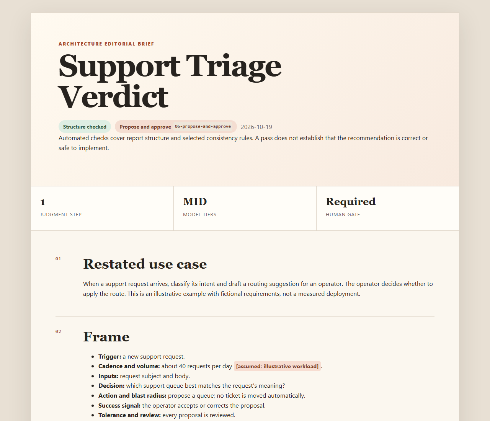

# Do I Need AI for This?

**Find the smallest architecture that gets the job done.**

An open-source agent skill for reviewing automation ideas and existing workflows.
Separate ordinary code, model judgment, and human approval, then get a clear HTML
report explaining what to build, what to skip, and why.

[](https://github.com/itsmeboris/Do-I-Need-AI-For-This/actions/workflows/ci.yml)
[](LICENSE)

[Install](#install) / [Try it](#try-it) / [Example report](examples/support-triage.html) / [Contribute](CONTRIBUTING.md)



## Why use it?

Before building an agent, work out where judgment is actually needed.

- **Choose an architecture:** ordinary code, a single model call, batch inference,
  a bounded agent, or a genuine agent loop.
- **Keep approval explicit:** show where a person must authorize an action.
- **Make assumptions visible:** identify what must be confirmed before building.
- **Review existing automation:** find model calls that deterministic code could replace.

The answer can be "no AI," "don't build it," or "an agent loop is appropriate."
The framework evaluates eight [composable patterns](skills/do-i-need-ai-for-this/framework/patterns/README.md).

## Install

### Agent skill: Codex, Claude Code, and other compatible agents

From your project directory:

```sh
npx skills add itsmeboris/Do-I-Need-AI-For-This
```

Choose your agent when prompted. Add `--global` to install for all your projects,
or select an agent explicitly:

```sh
npx skills add itsmeboris/Do-I-Need-AI-For-This --agent codex
npx skills add itsmeboris/Do-I-Need-AI-For-This --agent claude-code
```

This installs the skill and its bundled Python tools. Node.js/npm is required
for the installer; Python 3.10+ is required to check and render reports.
See the [skills CLI documentation](https://github.com/vercel-labs/skills) for options.

### Claude Code plugin

In Claude Code:

```text
/plugin marketplace add itsmeboris/Do-I-Need-AI-For-This
/plugin install do-i-need-ai-for-this@dinaift
```

Then invoke the packaged skill:

```text
/do-i-need-ai-for-this:do-i-need-ai-for-this Review my automation idea: ...
```

Choose either the skill installation or the plugin installation to avoid duplicate
entries. `verdict` and `audit` are modes selected from your request, not separate
slash commands.

To try a local checkout:

```sh
git clone https://github.com/itsmeboris/Do-I-Need-AI-For-This.git
cd Do-I-Need-AI-For-This
claude --plugin-dir .
```

### Manual installation and other hosts

Copy the entire `skills/do-i-need-ai-for-this/` folder into your agent's skills
directory. Keep its Python scripts and `framework/` directory together.

The repository also contains a Codex compatibility manifest. Plugin import and
file-delivery support vary by host and account. ChatGPT, Claude chat/mobile, and
Cowork workflows need a host with Python execution and writable files; they are
not yet end-to-end tested for this release. See [compatibility and packaging](docs/distribution.md).

## Try it

After installation, ask your agent:

> Use do-i-need-ai-for-this to review this idea: classify incoming support tickets,
> suggest a queue, and let an operator approve each move. We receive about 40
> tickets per day. Incorrect routing must be corrected before the ticket moves.

Or review an implementation in your workspace:

> Use do-i-need-ai-for-this to audit the automation in this repository. Find
> unnecessary model calls and missing human approval steps.

The skill asks about decision-changing unknowns, decomposes the workflow, and
returns a report at `docs/verdicts/YYYY-MM-DD-<slug>.html` in a persistent workspace.
Sandbox hosts return a downloadable HTML file when supported.

## What you get

| Part of the report | What it tells you |
| --- | --- |
| Frame | Trigger, inputs, volume, success signal, and constraints |
| Decomposition | Which steps use code, model judgment, or human authority |
| Recommendation | The smallest suitable pattern and why it fits |
| Alternatives and failure modes | What was ruled out and what can still go wrong |
| Revisit conditions and next step | When to reconsider and what to do first |

Reports are self-contained HTML with embedded CSS, printable layouts, and no
JavaScript or remote assets. Download [the example HTML](examples/support-triage.html)
and open it locally; GitHub displays its source. The [example input](examples/support-triage.md)
is fictional and is also used by the test suite.

**A checked report is not a correctness guarantee.** The Python checker verifies
required section presence and content, ordering, pattern identifiers, and selected
consistency rules. It does not prove the recommendation is correct, validate every
claim, or authorize actions. The report makes that boundary explicit.

## Privacy

The bundled Python tools run locally without network requests, telemetry, or
third-party Python dependencies. The skill instructs the host agent to use only
material available in the conversation or workspace.

Your host agent still processes that material under its own permissions and data
policies. Installation tools may make network requests and have their own telemetry;
see the [skills CLI privacy controls](https://github.com/vercel-labs/skills#telemetry).
Review reports before sharing them: they can contain information from your inputs.

## Development

```sh
python -m unittest discover -s tests -v
python skills/do-i-need-ai-for-this/check_verdict.py examples/support-triage.md
python skills/do-i-need-ai-for-this/render_verdict.py examples/support-triage.md report.html
```

No third-party Python packages are needed. See [CONTRIBUTING.md](CONTRIBUTING.md)
for the development workflow and [CHANGELOG.md](CHANGELOG.md) for changes.
This is a community-maintained project; it is not an official Anthropic or OpenAI plugin.

## License

[Apache License 2.0](LICENSE). Copyright 2026 Boris Sobol.
